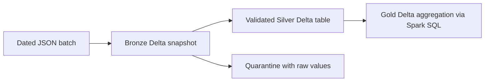

# PipelineX

- [Live demo](https://pipelinex-rishavraj.netlify.app/)
- [Production API documentation](https://pipelinex-wyrh.onrender.com/docs)

Select **Try Live Demo**, choose a scenario, and execute the pipeline. A production smoke test verified 100 orders through Bronze and Silver and 12 Gold groups. It also verified Gold recovery from Bronze and Silver checkpoints, required-field drift stopping before Silver, invalid results entering quarantine, and retry after an injected source timeout. The production API returned both analytical queries and a CSV, retrieved persisted run results, denied cross-session access, and enforced the five-run quota.

PipelineX processes synthetic retail orders through immutable Bronze snapshots, validated Silver records, quarantine and product revenue aggregates in Gold.

Run the dependency-free tests with `python -m unittest discover -s tests -v`.

For Spark, install Java 17 and Python 3.11, then run `python -m pip install -r requirements-spark.txt pytest`. Set `PIPELINEX_TEST_SPARK=1` and run `python -m pytest -q`. Spark resolves Delta's JVM dependencies from Maven on first start.

Use `python -m pipelinex.spark_engine orders.json lakehouse batch1` with newline-delimited JSON containing integer `order_id`, `customer_id`, `product_id` and `amount_cents`. Silver partitions by product and Gold runs a product-level Spark SQL aggregation. Use unique immutable batch IDs for new source snapshots. Reusing an existing batch ID restores its committed Delta stages. Schedule writers serially per batch.

The Airflow DAG expects date-stamped source files under `/data/source` and writes to `/data/lakehouse`. Its retries use the same date-derived batch ID. SCD1 MERGE is available as a separate helper and expects an already deduplicated input with a monotonic per-key watermark.

The Delta ingestion ledger reserves a source window before processing and marks it complete after Gold commits. It rejects new windows while a batch is pending. Use one namespace and one active writer per source. Historical windows produce separate batch outputs and leave the forward cursor unchanged. SCD2 uses an atomic Delta MERGE to expire a current row and insert its successor. The helper expects one ordered change per key in each batch.

For local Airflow, copy `.env.example` to `.env`, fill every value, and run `docker compose up --build`. Use a URL-safe database password. Create an Airflow administrator interactively with `docker compose exec airflow-web airflow users create` and its required account flags. Put dated NDJSON files in `data/source`. The default destination is the shared filesystem. To use MinIO, create a dedicated bucket and set `PIPELINEX_LAKEHOUSE` and `PIPELINEX_S3_ENDPOINT` as shown in the environment example. Serialize writers for each destination. The S3A configuration uses Delta's single-driver log store and does not support multiple independent writers.

### Lightweight recruiter demo

Run `pip install -r requirements-api.txt` with Python 3.11. Set `DATABASE_URL` to a dedicated PostgreSQL database and `CORS_ORIGINS` to `http://localhost:5173`. Run `alembic upgrade head` and `uvicorn pipelinex.api:app`. In `frontend`, run `npm ci` and `npm run dev`. FastAPI serves interactive documentation at `/docs`.

This mode uses bounded Python execution, JSON checkpoints and PostgreSQL run snapshots. It accepts only generated retail records and named failure scenarios, with up to 500 orders and five runs per one-hour session. New sessions trigger expired-session cleanup and admission is capped at 50 active sessions across workers. SQL is a choice of two read-only server-defined queries over synthetic Gold results. CSV exports and all run reads require the owning session. Keep demo credentials out of client builds. Configure ingress rate controls for public traffic.

The Netlify build expects `VITE_API_URL` set to the Render origin. Render expects `DATABASE_URL` and the exact Netlify origin in `CORS_ORIGINS`. Use a separate Neon database and role. These manifests are deployment configuration, not evidence of a live deployment.

### Measured local benchmark

Run `python bench.py` to generate and process deterministic synthetic orders. One Windows 11 run used Python 3.14.3 on an Intel Family 6 Model 142 CPU. Times include input generation and checkpoint I/O with tracemalloc enabled. Peak figures are traced Python allocations, not process RSS.

| Orders | Seconds | Peak Python bytes |
|---:|---:|---:|
| 1,000 | 0.2200 | 639,576 |
| 10,000 | 1.9825 | 4,858,460 |
| 100,000 | 27.2033 | 47,654,471 |

### Measured Spark benchmark

One [Java 17 Ubuntu CI run](https://github.com/rishavraj543256/pipelinex/actions/runs/45979598244) used Spark 3.5.5 in `local[2]` mode with Delta 3.3.2. Timings cover Spark processing, Delta I/O and reconciliation counts. Dataset generation is outside the timer. The first batch includes JVM warm-up, so the rows are not directly comparable as a scaling curve.

| Orders | Initial batch | Checkpoint replay |
|---:|---:|---:|
| 1,000 | 25.38 s | 1.64 s |
| 10,000 | 10.36 s | 1.25 s |
| 100,000 | 10.29 s | 1.27 s |

Each replay succeeded after the source file was removed. All benchmark batches reconciled input rows to Silver and Gold counts. This was single-host processing on a hosted runner; JVM peak memory was not measured.

The public demo does not read the Spark watermark ledger or SCD2 tables. Those features remain available through the full engine's Python interfaces.
