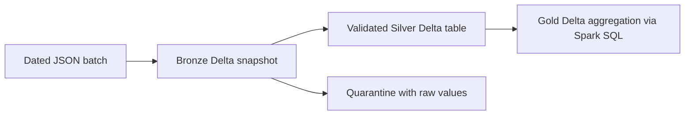

# PipelineX

PipelineX processes synthetic retail orders through immutable Bronze snapshots, validated Silver records, quarantine and product revenue aggregates in Gold.

Run the dependency-free tests with `python -m unittest discover -s tests -v`.

For Spark, install Java 17 and Python 3.11, then run `python -m pip install -r requirements-spark.txt pytest`. Set `PIPELINEX_TEST_SPARK=1` and run `python -m pytest -q`. Spark resolves Delta's JVM dependencies from Maven on first start.

Use `python -m pipelinex.spark_engine orders.json lakehouse batch1` with newline-delimited JSON containing integer `order_id`, `customer_id`, `product_id` and `amount_cents`. Silver partitions by product and Gold runs a product-level Spark SQL aggregation. Use unique immutable batch IDs for new source snapshots. Reusing an existing batch ID restores its committed Delta stages. Schedule writers serially per batch.

The Airflow DAG expects date-stamped source files under `/data/source` and writes to `/data/lakehouse`. Its retries use the same date-derived batch ID. SCD1 MERGE is available as a separate helper and expects an already deduplicated input with a monotonic per-key watermark.

The Delta ingestion ledger reserves a source window before processing and marks it complete after Gold commits. It rejects new windows while a batch is pending. Use one namespace and one active writer per source. Historical windows produce separate batch outputs and leave the forward cursor unchanged. SCD2 uses an atomic Delta MERGE to expire a current row and insert its successor. The helper expects one ordered change per key in each batch.

For local Airflow, copy `.env.example` to `.env`, fill every value, and run `docker compose up --build`. Use a URL-safe database password. Create an Airflow administrator interactively with `docker compose exec airflow-web airflow users create` and its required account flags. Put dated NDJSON files in `data/source` and make `data/lakehouse` writable by the container user. MinIO runs as a separate local service. The DAG writes to the shared filesystem; the MinIO connector is pending.

Work in progress includes the demo API and UI, benchmarks and hosting.
