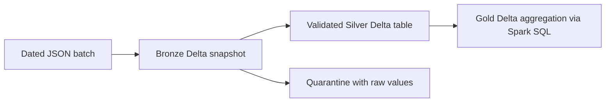

# PipelineX

PipelineX processes synthetic retail orders through immutable Bronze snapshots, validated Silver records, quarantine and product revenue aggregates in Gold.

Run the dependency-free tests with `python -m unittest discover -s tests -v`.

For Spark, install Java 17 and Python 3.11, then run `python -m pip install -r requirements-spark.txt pytest`. Set `PIPELINEX_TEST_SPARK=1` and run `python -m pytest -q`. Spark resolves Delta's JVM dependencies from Maven on first start.

Use `python -m pipelinex.spark_engine orders.json lakehouse batch1` with newline-delimited JSON containing integer `order_id`, `customer_id`, `product_id` and `amount_cents`. Silver partitions by product and Gold runs a product-level Spark SQL aggregation. Use unique immutable batch IDs for new source snapshots. Reusing an existing batch ID restores its committed Delta stages. Schedule writers serially per batch.

The Airflow DAG expects date-stamped source files under `/data/source` and writes to `/data/lakehouse`. Its retries use the same date-derived batch ID. SCD1 MERGE is available as a separate helper and expects an already deduplicated input with a monotonic per-key watermark.

Work in progress includes SCD2, source watermark persistence, full Compose infrastructure, the public demo API and UI, benchmarks and hosting.
